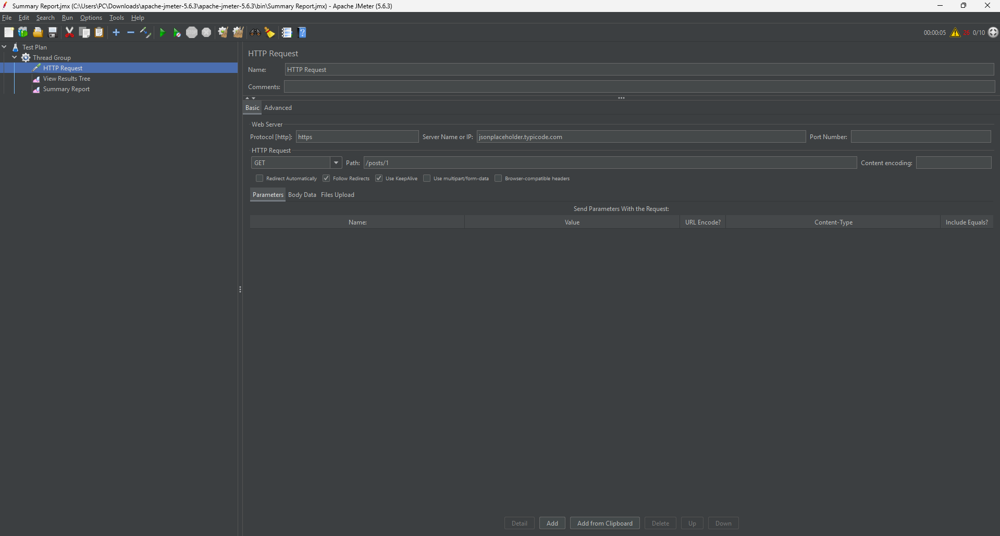
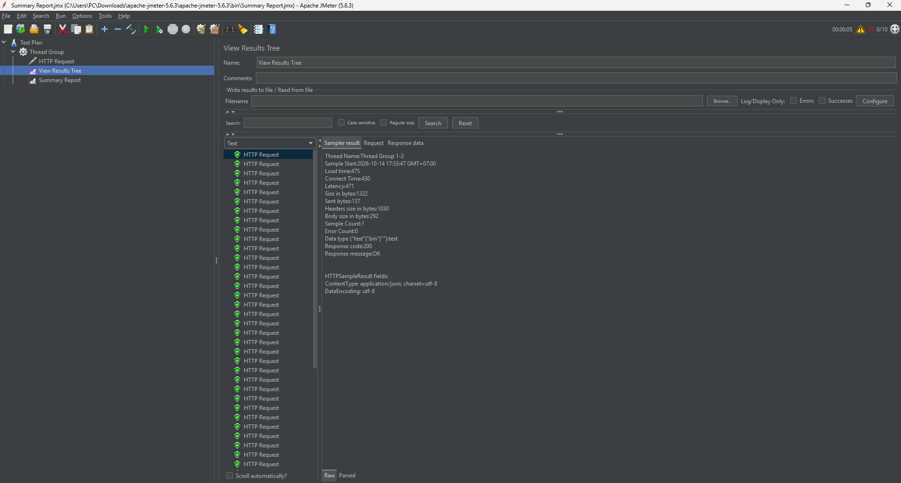
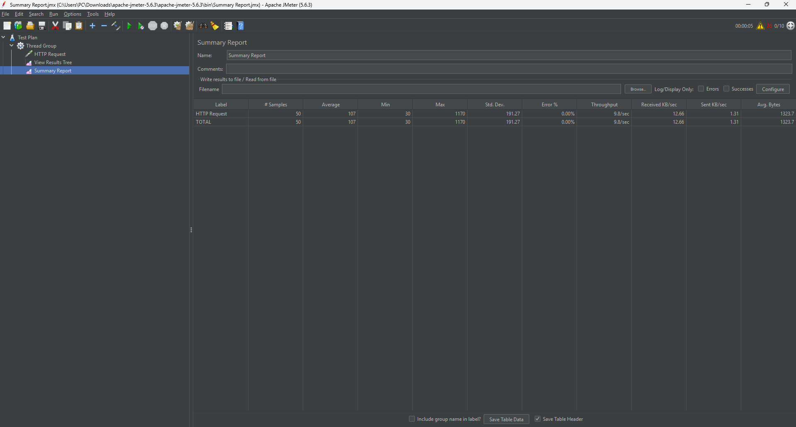

# Kiểm thử hiệu năng với Apache JMeter

## 1. Giới thiệu

Apache JMeter là một công cụ mã nguồn mở được sử dụng để kiểm thử hiệu năng, kiểm thử tải và kiểm thử chức năng cho ứng dụng web và API.

Dự án này minh họa cách sử dụng Apache JMeter để kiểm thử một REST API bằng cách gửi các yêu cầu HTTP và phân tích kết quả hiệu năng.

## 2. Mục tiêu

- Tìm hiểu các tính năng cơ bản của Apache JMeter.
- Tạo và cấu hình kế hoạch kiểm thử.
- Thực hiện kiểm thử yêu cầu HTTP.
- Phân tích thời gian phản hồi, thông lượng và tỷ lệ lỗi.
- Ghi lại ảnh chụp màn hình để minh họa quá trình kiểm thử.

## 3. Công cụ và công nghệ

- **Apache JMeter:** 5.6.3
- **Môi trường lập trình:** Java JDK
- **Hệ điều hành:** Windows
- **Công cụ kiểm thử:** Apache JMeter
- **API kiểm thử:** JSONPlaceholder

## 4. Môi trường và cấu hình kiểm thử

API được sử dụng cho bài kiểm thử là:

`https://jsonplaceholder.typicode.com/posts/1`

Yêu cầu HTTP đã được cấu hình như sau:

| Cấu hình                  | Giá trị                        |
| ------------------------- | ------------------------------ |
| Giao thức                 | HTTPS                          |
| Tên máy chủ               | `jsonplaceholder.typicode.com` |
| Phương thức               | GET                            |
| Đường dẫn                 | `/posts/1`                     |
| Số luồng                  | 10                             |
| Khoảng thời gian tăng tải | 5 giây                         |
| Số lần lặp                | 5                              |

Bài kiểm thử mô phỏng 10 người dùng ảo, mỗi người dùng gửi 5 yêu cầu. Tổng số yêu cầu dự kiến là 50.

## 5. Quy trình kiểm thử

1. Cài đặt Java JDK và Apache JMeter.
2. Mở Apache JMeter và tạo mới Test Plan.
3. Thêm và cấu hình Thread Group.
4. Thêm sampler HTTP Request.
5. Thêm listener View Results Tree.
6. Thêm listener Summary Report.
7. Chạy kiểm thử và kiểm tra kết quả yêu cầu.
8. Phân tích các số liệu hiệu năng.
9. Lưu kế hoạch kiểm thử và ảnh chụp màn hình.

## 6. Kết quả kiểm thử

### 6.1 Cấu hình Thread Group

Thread Group được cấu hình với 10 người dùng ảo, thời gian ramp-up là 5 giây và số lần lặp là 5.


### 6.2 Cấu hình HTTP Request

Sampler HTTP Request đã gửi yêu cầu GET đến endpoint API JSONPlaceholder `/posts/1`.



### 6.3 View Results Tree

Listener View Results Tree được sử dụng để kiểm tra từng yêu cầu và phản hồi tương ứng. Yêu cầu đã kiểm tra trả về mã trạng thái HTTP 200 (OK).



### 6.4 Summary Report

Summary Report hiển thị các thống kê hiệu năng tổng quát được thu thập trong quá trình kiểm thử.



### 6.5 Phân tích hiệu năng

Bài kiểm thử được thực hiện với 10 người dùng ảo, thời gian ramp-up là 5 giây và 5 lần lặp cho mỗi người dùng.

Kết quả được tóm tắt như dưới đây:

| Chỉ số                        |          Kết quả |
| ----------------------------- | ---------------: |
| Tổng số mẫu                   |               50 |
| Thời gian phản hồi trung bình |           107 ms |
| Thời gian phản hồi tối thiểu  |            30 ms |
| Thời gian phản hồi tối đa     |         1,170 ms |
| Độ lệch chuẩn                 |        191.27 ms |
| Tỷ lệ lỗi                     |            0.00% |
| Thông lượng                   | 9.8 yêu cầu/giây |

**Phân tích:**

- Tất cả 50 yêu cầu HTTP hoàn tất mà không gặp lỗi trong bài kiểm thử này.
- Thời gian phản hồi trung bình là 107 ms.
- Thời gian phản hồi tối thiểu là 30 ms, trong khi tối đa là 1,170 ms.
- Tỷ lệ lỗi là 0.00%, nghĩa là không có yêu cầu nào bị thất bại trong bài kiểm thử này.
- Thông lượng khoảng 9.8 yêu cầu trên giây.

Kết quả cho thấy API phản hồi thành công trong điều kiện kiểm thử đã cấu hình. Tuy nhiên, thời gian phản hồi có sự thay đổi. Cần thêm các bài kiểm thử với số lượng người dùng ảo cao hơn để đánh giá hiệu năng dưới tải nặng hơn.

## 7. Kết luận

Dự án này mang lại kinh nghiệm thực tế về việc sử dụng Apache JMeter để kiểm thử hiệu năng API. Một kế hoạch kiểm thử đã được tạo, các yêu cầu HTTP đã được thực thi và các chỉ số hiệu năng đã được thu thập và phân tích.

Bài kiểm thử ghi nhận tỷ lệ lỗi 0.00% trên tổng số 50 yêu cầu, với thời gian phản hồi trung bình là 107 ms. Thực nghiệm này minh họa quy trình cơ bản của kiểm thử hiệu năng API. Cần thêm các bài kiểm thử để đánh giá hiệu năng ở mức tải cao hơn.

## 8. Cấu trúc dự án

```text
jmeter-performance-testing/
├── README.md
├── test-plans/
│   └── api-test.jmx
└── screenshots/
    ├── 01-thread-group.png
    ├── 02-http-request.png
    ├── 03-view-results.png
    └── 04-summary-report.png
```

## 9. Tài liệu tham khảo

- [Apache JMeter Official Website](https://jmeter.apache.org/)
- [Apache JMeter User Manual](https://jmeter.apache.org/usermanual/)
- [JSONPlaceholder](https://jsonplaceholder.typicode.com/)
